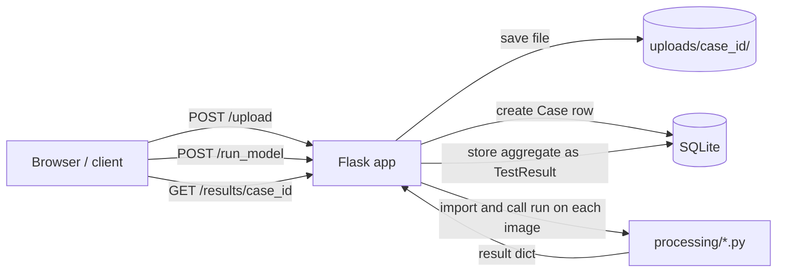

# Architecture overview

This page describes how Librecorder is built today, based on the code on `main`. For the long-term vision, see the diagrams at the end.

## Components

| Component | Where | What it does |
|---|---|---|
| Web server | `Software/WebApp/app.py` | A single Flask app. Serves the dashboard and a JSON API for cases, files, models and results. |
| Database | `Software/WebApp/models.py`, `Software/WebApp/openlims.db` | SQLite via Flask-SQLAlchemy. Two tables: `Case` and `TestResult`. (`instance/openlims.db` is unused.) |
| File storage | `Software/WebApp/uploads/<case_id>/` | Uploaded images and text notes, one folder per case, plus an optional `meta.json`. |
| Classifier plugins | `Software/processing/*.py` | One Python file per model. Discovered automatically by the server. |
| Dashboard | `Software/WebApp/templates/`, `static/` | The browser UI (HTML/CSS/JS). |
| Desktop upload client | `Software/WebApp/upload_pic.py` | A small tkinter tool that picks a file and uploads it to the server (points at the live server by default). |

The live instance at [microlab.parccommons.org](https://microlab.parccommons.org/) is deployed separately and currently differs from `main`.

## How a request flows



1. A client uploads an image (`POST /upload`). The server saves it under `uploads/<case_id>/` and creates a `Case` row if the case is new.
2. The client asks for a model to run on a case (`POST /run_model` with `case_id` and `model_id`).
3. The server finds the plugin whose `MODEL_ID` matches, calls its `run()` on every image in the case, and builds a simple aggregate.
4. The aggregate is stored as one `TestResult` row and returned together with the per-image results.

## Classifier plugins

A plugin is any `.py` file in `Software/processing/` that defines:

| Name | Type | Purpose |
|---|---|---|
| `MODEL_ID` | str | Unique ID used to select the model (e.g. `dark_light_v1`). Defaults to the file name. |
| `MODEL_NAME` | str | Human-readable name shown in the UI. Defaults to the file name. |
| `run(image_path)` | function → dict | Analyses one image and returns a dictionary of results. |

The server discovers plugins by scanning `processing/*.py` each time `/models` or `/run_model` is called. It skips files starting with `_` and files that fail to import (for example because `torch` is not installed). `/models` skips files without `run()`; `/run_model` returns an error if the matching file has no `run()`.

Current plugins:

| File | `MODEL_ID` | Returns |
|---|---|---|
| `dark_light.py` | `dark_light_v1` | `classification`, `sigmoid_score`, `mean_val`, `units` |
| `mean_pixel.py` | `mean_pixel_v1` | `mean_pixel` |
| `malaria_cnn.py` | `malaria_cnn_v1` | `classification`, `confidence`, `p_infected`, `p_uninfected` (needs `torch`) |

A standard output format for `run()` is being introduced, based on the v0.1 report format (issues #37 and #40). Tests that check new classifiers against it will follow.

## Data model

| Table | Columns |
|---|---|
| `Case` | `id`, `case_id` (unique), `created_at`, `description` |
| `TestResult` | `id`, `case_id` → `Case.case_id`, `test_name`, `result`, `units`, `timestamp` |

The schema is created with `db.create_all()` at startup. This creates missing tables but never changes existing ones, so any schema change needs a migration for existing databases, including the live one.

## API routes

| Group | Route | Method | Purpose |
|---|---|---|---|
| Pages | `/` | GET | Dashboard |
| | `/upload_image` | GET | Browser upload form |
| | `/render/<case_id>` | GET | Case viewer page |
| | `/rich_results/<case_id>` | GET | Images with result overlays |
| Cases and files | `/upload` | POST | Upload one `.jpg`/`.jpeg`/`.txt` file (form field `file`, optional `case_id`) |
| | `/import_folder` | POST | Copy images (`.jpg`, `.png`, `.tif`…) from a folder on the server into a case, new unless `case_id` is given (JSON `src`, optional `case_id`, `description`) |
| | `/cases` | GET | List cases |
| | `/cases/<case_id>` | GET | List files in a case |
| | `/cases/<case_id>/<filename>` | GET | Download a file |
| | `/meta/<case_id>` | GET, POST | Read or save case metadata (`meta.json`) |
| | `/purge/<case_id>` | DELETE | Delete a case, its files and its results |
| Models | `/models` | GET | List discovered plugins |
| | `/run_model` | POST | Run a plugin on every image in a case (JSON `case_id`, `model_id`) |
| | `/process` | POST | Run a plugin by file name on a single file (form `case_id`, `filename`, `processor`) |
| Results | `/record_result` | POST | Store a result manually (JSON `case_id`, `test_name`, `result`, optional `units`) |
| | `/results/<case_id>` | GET | List stored results for a case |

## Current limitations

These are known gaps, listed so contributors know what to expect:

- **Aggregation only understands two keys.** `/run_model` averages `mean_pixel` and counts `classification`. Other keys appear in the per-image response but are not aggregated.
- **Per-image results are not stored.** Only the aggregate is saved, as a Python-style string (not JSON) in `TestResult.result`, declared as 128 characters. SQLite ignores that limit, but other databases would not.
- **Plugins are re-imported on every request** to `/models` and `/run_model`.
- **No authentication** on any route.
- **Duplicate `MODEL_ID`s aren't detected.** `/run_model` uses the first file alphabetically.
- **`/rich_results` shows every stored result on every image**, because results aren't matched to images.
- **Schema changes need migrations** (see Data model).

## Repository layout

```
README.md, CONTRIBUTING.md, LICENSE
requirements.txt          web server dependencies
environment.yml           training environment for the malaria classifier
docs/setup.md             setup guide
docs/codebase/            architecture (this page)
docs/research/            research guide and reports
Software/
  WebApp/                 Flask server, dashboard, database
  processing/             classifier plugins
  basic_classifier/       sample images and an early prototype
  malaria_classifier/     malaria model training and data
```

## Vision diagrams

These diagrams were previously in the main README.

The most recent architecture:


An older, different view of the same thing:


